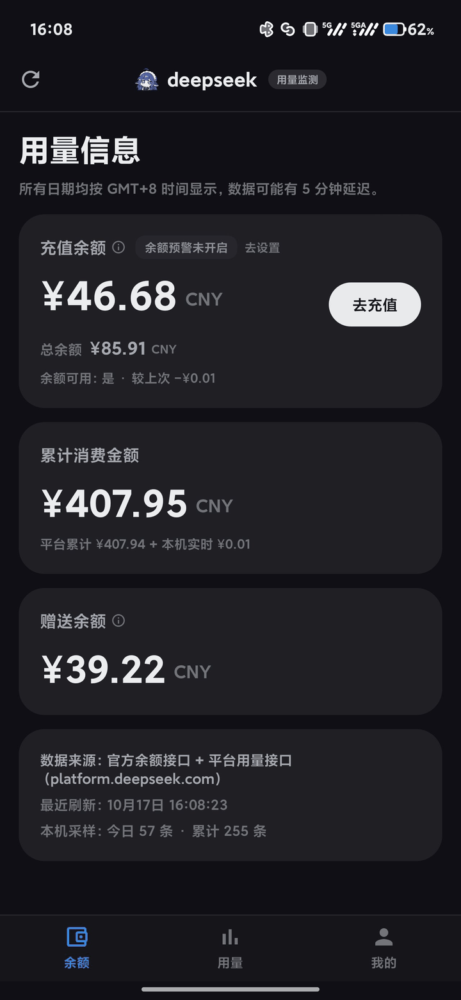
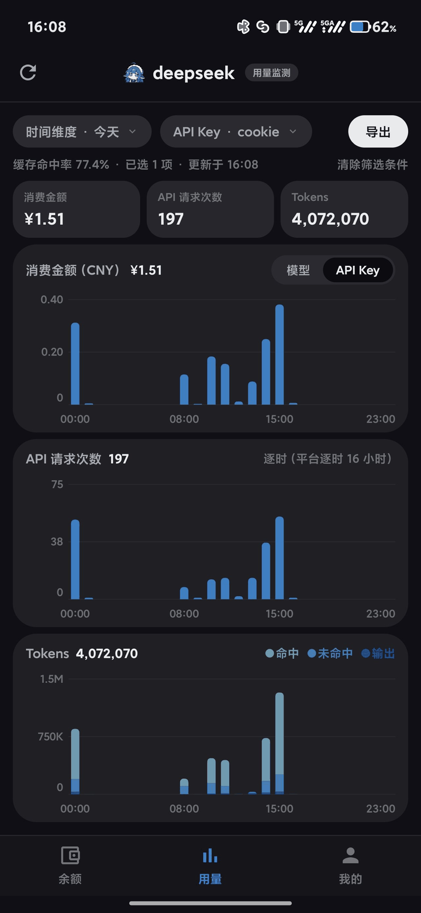
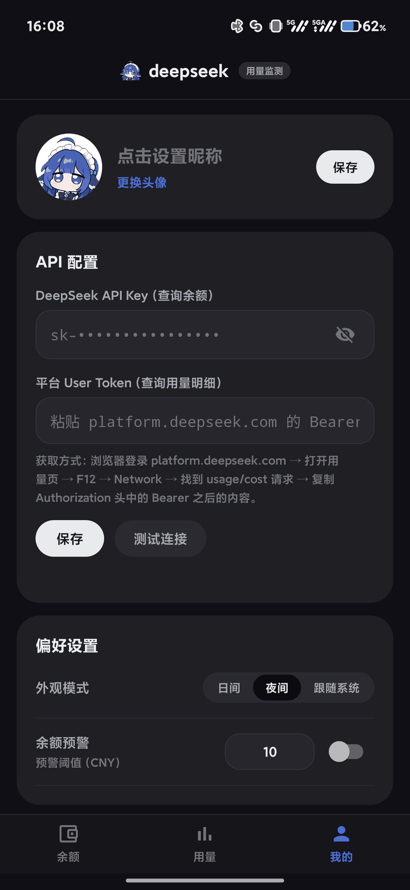
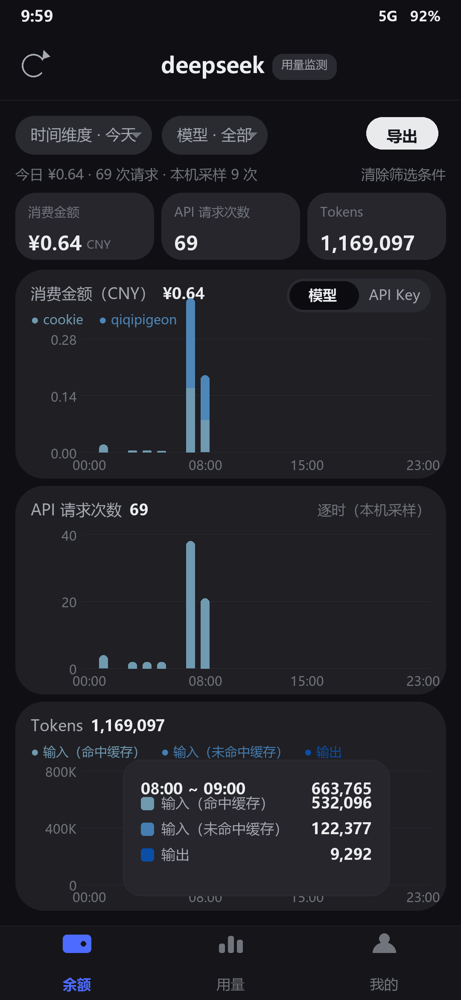

# DSMonitor · DeepSeek 用量监测

<!-- CI 徽章暂时隐藏：workflow 还在（.github/workflows/build.yml），修好后把下面这行取消注释即可
[](https://github.com/PigeonCookie/ds-usage-monitor/actions/workflows/build.yml)
-->
[](LICENSE)


一个**轻量**的安卓用量监测 App：APK 约 **380 KB**，纯 Android framework 实现，**没有 AndroidX、没有 Gradle、没有任何第三方依赖**。
界面参照 DeepSeek 开放平台的暗色风格，底部三个栏目：**余额 / 用量 / 我的**。所有密钥只存在本机，请求只发往 `api.deepseek.com` 与 `platform.deepseek.com`。

> **声明**：本项目是 **DeepSeek vibe coding** 的产物 —— 代码、界面与文档由 DeepSeek 模型生成，作者负责审阅、测试与发布；构建在本地用标准 Android 工具链完成（`aapt2` / `javac` / `d8` / `zipalign` / `apksigner`），**不是 DeepSeek 官方编译或发布的软件**，与 DeepSeek 官方无隶属关系。
>
> **Notice**: this project is produced by **DeepSeek vibe coding** — the code, UI and documentation were generated by a DeepSeek model, then reviewed, tested and released by the author. It is built locally with the standard Android toolchain; it is **not compiled or published by DeepSeek** and is not affiliated with DeepSeek.

| 余额 | 用量 | 我的 |
| --- | --- | --- |
|  |  |  |

点柱子弹出该时段明细（Tokens 会拆成 输入（命中缓存）/ 输入（未命中缓存）/ 输出）：

<!-- 想展示弹窗：点开任意一根柱子截一张，存为 preview/preview-usage-tooltip.png，再把下面这行的注释打开

-->

> `preview/*.png` 是真机截图（1280×2772），直观展示实际界面效果。

---

## 1. 功能

**第一页 · 余额**
- **充值余额**（`topped_up_balance`，与开放平台一致）、**累计消费金额**、**赠送余额** 三张卡片；卡片下方另有**总余额**一行。
- 左上角**重载**按钮（加载时图标旋转）。
- **离线标记**：余额请求失败时保留最后一次的数值，并在说明行标出 `⚠ 离线：以下为 x 月 x 日 xx:xx 的数据`，不会把旧数字当实时。
- **余额下降**：数字滚动、闪橙色、轻微脉冲，并飘出 `−¥0.xx` 浮标；**充值**（余额上升）飘绿色 `+¥xx` 浮标。
- **累计消费**：上涨时滚动并闪橙色（花钱=预警色），**数值只增不减**（数据回落时保持原值，不闪色）。
- **累计消费实时跟随**：平台累计（跨月扫描，缓存 5 分钟）在余额下降时立刻加上"本机实时增量"，卡片下方注明 `平台累计 ¥xxx + 本机实时 ¥0.xx`；只填 API Key 时用本机估算（初始余额 + 充值 − 当前余额）。
- `余额预警已开启/未开启` 徽标 + `去设置`；低于阈值发通知；`去充值` 打开官方充值页。

**第二页 · 用量**
- **三张柱状图压在一页**（消费金额 / API 请求次数 / Tokens），按屏幕高度权重自适应，三张图时间轴严格对齐（Y 轴刻度预留固定槽宽）。
- **模型 / API Key 分段开关** + 多选筛选：同时勾选多个项时，柱状图变成多条叠加系列并出现色点图例。
- **每根柱子都能点**：弹出该时段明细（标题 + 合计 + 分项）；消费图按当前维度列出每个 Key / 模型的金额，Tokens 图列出三种 Token；点空白处、点同一根柱子或换选都会关闭。
- 时间维度：**今天 / 昨天 / 近 7 天 / 近 30 天 / 本月 / 自定义时间**（月历区间选择器，可翻月、区间连选）。
  今天与昨天都是**逐小时**柱状图；昨天首次查看时按小时向平台补齐该日 0~23 点，之后走本地缓存。
- **提示行**：`缓存命中率 xx.x%`（今天 / 昨天，= 命中缓存输入 ÷（命中 + 未命中缓存输入））、`日均 ¥x/天`（近 7/30 天、本月、自定义，分母是区间内**有消费的天数**），后面跟`已选 N 项`（没筛选项时显示 `已选 全部`）与 `更新于 HH:mm`；与上方卡片重复的合计数字不再重复显示。
- **选择会被记住**（时间维度、维度开关、多选项）；`清除筛选条件` 一键回默认。
- `导出` 生成当前视图 CSV（复制到剪贴板或保存文件），日范围会为每个选中项多出一列。

**第三页 · 我的**
- 头像（相册选择，自动裁剪压缩）与昵称；**DeepSeek API Key**（明文/密文切换）与**平台 User Token** 输入，`保存` 与 `测试连接`（分别探测两个接口，并回显今日数据、导出字段明细与平台逐时）。
- **日间 / 夜间 / 跟随系统**：切换后停留在当前页（标签页也会记住）。
- 余额预警（阈值 + 开关，默认关闭，只控制是否发通知）；后台每 15 分钟自动检查，刷新用量时记一条本机采样（最多保留 7 天）。
- **自定义 User-Agent**：长按「关于」里的版本行即可填写（留空=内置默认）。平台哪天加了 UA 校验，你可以直接从浏览器复制一个真实 UA 填进去，不必等新版本。
- 关于卡片：内嵌 logo、版本、数据来源与隐私说明。

---

## 2. 数据来源与口径

- API Key 与平台 User Token 使用 **Android Keystore 的 AES-GCM** 加密后存储在应用私有目录；密钥不可导出（支持时由 TEE 保管），**连 App 自己都读不出密钥本体**。旧版本明文保存的值在首次读取时自动加密迁移，无需重新粘贴。

| 数据 | 接口 | 认证 |
| --- | --- | --- |
| 充值 / 赠送 / 总余额 | `GET https://api.deepseek.com/user/balance` | `Authorization: Bearer <API Key>` |
| 用量明细（按日期 × Key × 模型 × 类型） | `GET https://platform.deepseek.com/api/v0/usage/export?start=&end=&tz=0`（zip/CSV） | `Bearer <平台 User Token>` |
| 回退：月度用量 / 消费 | `GET https://platform.deepseek.com/api/v0/usage/{amount,cost}?month=&year=` | 同上 |

**平台 User Token 获取**：浏览器登录 platform.deepseek.com → 打开用量页 → F12 → Network → 找到 `usage/cost` 请求 → 复制 `Authorization` 头里 `Bearer` 之后的内容（App 第三页也有同样提示）。

口径说明（这些都是踩过坑才定下来的，改了会全线不一致）：

- **日合计**：始终取自导出接口，按**本地日**取值 —— 每个本地日单独发一个 `[D 00:00, D+1 00:00)` 窗口（导出接口本身按 UTC 日给行，直接用 UTC 日会让柱状图整体偏移 8 小时）。已完成的历史日期会落盘缓存，重复查看不再请求。
- **逐时曲线**：优先取**平台逐时** —— 「今天」每个已结束的小时、「昨天」全部 24 个小时各自单独请求 `[H:00, H+1:00)`（昨天首查 24 次，落盘缓存后不再重复），一个桶就是一个窗口，与开放平台同口径；**正在进行的这一小时 = 当日合计 − 已结束小时之和**（分类型相减），所以三张图加总严格等于卡片，不做任何"校准缩放"。
- **兜底**：平台逐时取不到（没填 Token / 缓存为空 / 请求失败）时**不画估算曲线** —— 三张图留空，提示行写明「官网逐时未取到，请刷新重试」，避免用本机采样顶替出看起来像官网、其实是估算的柱子。
- **小字口径**：今天 / 昨天显示**总缓存命中率** = 命中缓存输入 ÷（命中缓存输入 + 未命中缓存输入），按当前选中项统计；区间视图显示 `日均` = 区间消费 ÷ **有消费的天数**（消费为 0 的日期不计入分母）。`日均` = 区间消费 ÷ **有消费的天数**（消费为 0 的日期不计入分母）；两者都按当前选中的 Key / 模型统计。
- **数据优先级（重要）**：图表逐时值**平台优先** —— 只要平台逐时缓存里有数据就用平台的整点窗口值；平台取不到（没填 Token / 缓存为空 / 请求失败）时**留空并提示刷新**，并在图卡右上角写明当前来源（`逐时（平台逐时 N 小时）` / `逐时（本机采样）`）。卡片数字**永远**来自当次请求，不受缓存影响；余额或逐时请求失败时页面会显示 `⚠ 离线` 并保留上次的值。
- **平台恢复后自动切回**：进「今天」时会检查 0 点～上一整点里哪些小时还没缓存、补齐；旧版本留下的"整天禁用"标记文件（`hourly-off-<日期>`）在读取时就地删除，所以平台一好、下次进入即回到平台数据，无需重装或清数据。
- **本机采样无权否决平台**：采样只用来给"本机没采全"的小时打一个存疑标记（弹窗里注明「本机未采全，以官网为准」），**绝不**因为采样值偏低就丢弃平台数据；采样本身也不会被写进平台缓存，两套数据互不污染。
- **已缓存的小时当天不重取**：整点窗口是终值，同一小时内不会重复请求（当天数据当天定稿，跨天自然重算）。
- **三种 Token**：优先按平台字段名归类（`input_cache_hit_tokens` → 命中缓存、`input_cache_miss_tokens` → 未命中缓存、`output_tokens` → 输出）；字段名无法识别时才退化为"按行单价排序"（最便宜=命中、最贵=输出）。
- 导出接口不可用时回退月度接口（此时只能按模型拆，按 Key 拆会提示"该区间无法按 API Key 拆分"）。
- 累计消费：优先一次宽窗口导出统计全部消费，失败时逐月回退，取历史最大值，避免部分失败把数字改小。

---

## 3. 安装

从 [Releases](../../releases) 下载 APK（或自行构建，见下），拷进手机点击安装（需允许安装未知来源应用）。

- 包名 `com.pigeoncookie.dsmonitor`，minSdk 23（Android 6.0），targetSdk 34，锁竖屏。
- 权限：`INTERNET`、`ACCESS_NETWORK_STATE`、`POST_NOTIFICATIONS`（余额预警）、`RECEIVE_BOOT_COMPLETED`（恢复后台采样）。

## 4. 构建

不需要 Gradle / Android Studio：

```powershell
tools\build.cmd                                            # 或
powershell -ExecutionPolicy Bypass -File tools\build.ps1 -Sdk "C:\Android\sdk"
```

依赖：**JDK 17+**（`javac` / `keytool` 在 PATH 或 `JAVA_HOME` 里）与 **Android SDK**：

```bash
sdkmanager --install "platforms;android-34" "build-tools;35.0.0"
```

流程：`aapt2 compile` → `aapt2 link` → `javac --release 11` → class 打包成一个归档交给 `d8` → `classes.dex` 打进 APK → `zipalign` → `apksigner` 签名 → 跑纯 JVM 自测。

> 为什么用 build-tools **35**：34 的 `d8` 处理本项目部分匿名内部类会内部报错，且直接传 90 个 class 路径会超出 Windows 命令行长度上限。

**签名**：仓库**不含任何密钥**。首次构建会用 `keytool` 在 `keystore/dsmonitor.jks` 生成一个本地密钥（alias/口令默认 `dsmonitor`），也可以指定自己的：

```powershell
tools\build.ps1 -Keystore D:\keys\my.jks -StorePass <口令> -KeyAlias <别名>
```

`keystore/` 已在 `.gitignore` 中 —— **千万不要把自己的签名密钥推到公开仓库**。

> Android Studio 用户注意：AGP 8 不接受 `AndroidManifest.xml` 里的 `package` 属性（脚本构建又必须保留它）。若要改用 Gradle，请删除该属性并在 `app/build.gradle` 里设置 `namespace = "com.pigeoncookie.dsmonitor"`。

## 5. 测试

```powershell
java -cp .build\tests com.pigeoncookie.dsmonitor.core.CoreTest     # 构建脚本会自动跑
```

`tools/jvm-tests/CoreTest.java` 是**纯 JVM 测试**（不需要设备/模拟器），当前 **81 项全绿**，覆盖：JSON 解析、余额响应、月度 amount/cost 响应、导出 CSV 与 zip、三种 Token 归类（含"字段名不认识时按单价判定"）、按 Key/模型聚合、金额与 Token 格式化、多月合并、逐时缓存往返（格式与分项存活）。

## 6. 目录结构

```
app/src/main/
  AndroidManifest.xml
  java/com/pigeoncookie/dsmonitor/
    MainActivity.java          单 Activity：顶栏 + 三页 + 底部导航（记住上次所在页）
    Page.java / PageHost.java  页面抽象与宿主接口
    DashboardPage.java         第一页（余额、涨跌浮标、累计消费）
    UsagePage.java             第二页（三图一页、维度多选、自定义区间、弹窗、导出）
    ProfilePage.java           第三页（头像 / 密钥 / 外观 / 预警）
    DateRangeDialog.java       月历区间选择器
    MoneyText.java             金额滚动 + 涨/跌高亮
    BarChartView.java          无依赖柱状图（网格、单列/分组/堆叠、点击弹窗、动画）
    Ui.java                    主题包装、圆形裁剪、dp / 取色
    core/                      Json、Http、Fmt、Prefs、Balance、UsageData、DeepSeekClient、
                               SampleStore、LocalDayCache、UsageRepo、Bg
    data/                      HourlyCache（平台逐时）、TodayBackfill（逐时补齐）、
                               SampleJobService（后台余额检查 + 采样）、BootReceiver、Alerts
  res/  layout / values / values-night / drawable / mipmap*
tools/  build.ps1 / build.cmd（构建）、setup-sdk.ps1（SDK 安装）、
        make_icons.py（图标生成）、render_preview*.py（设计预览）、set_version.py、
        jvm-tests/CoreTest.java
preview/ 设计预览图
```

## 7. 图标

角色立绘是深色背景，`tools/make_icons.py` 的处理方式：

1. 四角 flood fill（阈值 40）抠掉近黑背景，掩膜膨胀约 3px 消除 JPEG 暗边；**裁掉原图底部 6% 的渐变**。
2. 自适应图标按 **72/108 安全区**构图（启动器会裁掉外层，铺满整幅反而会被放大裁切）；传统方形/圆形图标则铺满画布并**切到下沿以下**，避免底部出现白边。
3. 输出白底圆角方形、圆形、自适应前景（白色背景层）、应用内 logo 与顶栏透明小标，全部为 WebP。

```bash
python tools/make_icons.py --src art/character.png    # 换图后重跑；依赖 Pillow + numpy
```

> 源立绘不入库（`art/` 已加入 `.gitignore`，默认读取 `art/character.png`，也可用 `--src` 或环境变量 `DSMON_ART` 指定）；生成好的图标本身已提交在 `res/` 里，普通贡献者无需重新生成。

> 换图标后桌面若仍显示旧图标，是启动器的图标缓存，卸载重装一次即可。

## 8. 隐私与已知限制

- 所有密钥只写入本机 `SharedPreferences`（应用私有目录，未加密；清单里已设 `android:allowBackup="false"`，`adb backup` 无法导出）；请求只发往 `api.deepseek.com` 与 `platform.deepseek.com`，不上传任何第三方服务器。
- **API Key 只能查余额**，用量明细必须填平台 User Token。
- 后台采样任务带 **5 分钟 flex 窗口**（`:setPeriodic(15min, 5min)`），Doze 下不易被跳过；每条样本记录的是**真实落点时间**，逐时曲线用的就是这个时间。
- **历史缓存预热**：每次进入「今天」会顺带把最近 30 天里尚未缓存的日子补 3 天（由远及近），约十次就全部落盘（保留 60 天）。之后**平台接口不可用时，近 7 天 / 近 30 天 / 本月仍可翻看**，本月/逐时等取不到的部分会按上面的离线标记提示。
- 消费金额由"行单价 × 数量"累加，与官网内部结算精度存在**末位分级舍入差**（通常 1 分）。
- 多选多项时，逐时同样走平台逐时（缓存里本就按 Key/模型分行存储）；平台逐时不可用时三张图留空并提示刷新。
- 「今天」的逐时依赖平台逐时补齐：首次进入当天需要逐个已结束小时各发一次请求（有进度提示），之后当天不再重复；历史日期有磁盘缓存。
- 首次启动默认**夜间模式**，与开放平台观感一致；界面锁竖屏（"三图一页"按竖屏高度分配权重）。

## 9. 协议

代码以 [MIT](LICENSE) 协议开源。

**App 图标与角色立绘不是本项目作者的原创作品**：它们是由 AI 生成、且**已获得原作者许可**使用的第三方素材，**不在 MIT 授权范围内**；该许可不会自动延伸到你的 fork，若要再分发请保留出处或换成自己的图：

```bash
python tools/make_icons.py --src <你的图.png>
```

DeepSeek 名称与标识归其所有者；本项目为非官方第三方工具。
